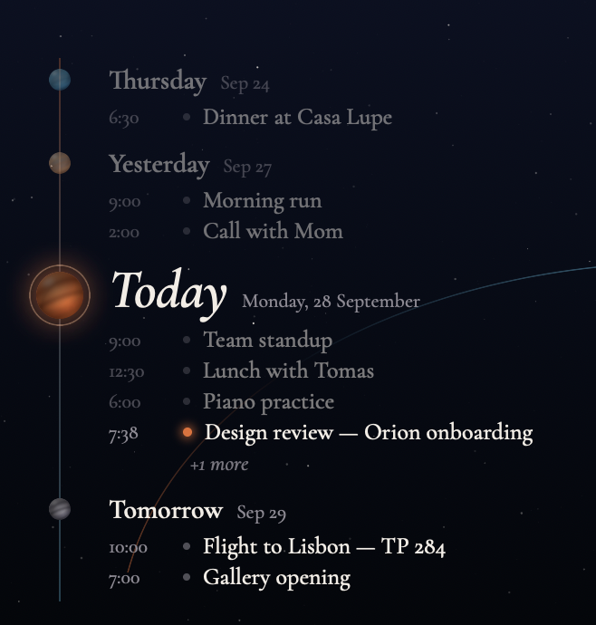

# Timeline

A quiet desktop widget for macOS that renders your Apple Calendar as a vertical
timeline of days — a small "planet" node per day on a single line, with Today
enlarged in the middle, past days above, and upcoming days below.



- One glance: yesterday, today, tomorrow, and beyond.
- Click an event to open a small detail card (title, calendar, time, location,
  notes, attendees, recurrence, alerts) — with "Open in Calendar" to jump to the
  event in Calendar.app.
- Choose which calendars appear in the widget's settings.
- Set entirely in Cormorant Garamond over a deep-space background.

## Requirements

- macOS 14 (Sonoma) or later
- Xcode 15+ to build, or just `scripts/install.sh` (`brew install xcodegen`
  recommended; the committed `TimelineWidget.xcodeproj` also works)

## Install

```bash
scripts/install.sh
```

This generates the project (if `xcodegen` is present), builds a Release binary
with ad-hoc code signing, copies `Timeline.app` to `/Applications`, registers
the widget extension, and opens the app.

Then:

1. In the app, click **Allow calendar access** and approve the system prompt.
2. Right-click the desktop → **Edit Widgets** → search for **Timeline** → drag
   the large widget onto the desktop.

To choose which calendars show up: right-click the widget → **Edit Timeline** →
pick calendars (empty = all).

## How clicking an event works

The widget uses interactive-widget buttons (`Button(intent:)`, macOS 14+).
Tapping an event row runs `SelectEventIntent`, which stores the event identifier
in the widget extension's local defaults; the timeline reloads and renders a
detail card overlaid on the timeline. The selection expires after two minutes.
"Open in Calendar" links to `ical://ekevent/<id>`.

## Project layout

```
project.yml                    XcodeGen spec (xcodegen generate)
Timeline/                      Host app (SwiftUI)
TimelineWidgetExtension/       WidgetKit extension (systemLarge)
Shared/                        Models, EventKit loading, theme, views, fonts
Shared/Fonts                   Cormorant Garamond TTFs + OFL.txt
scripts/install.sh             Build + install
scripts/render_snapshots.sh    Render widget PNGs with demo data
scripts/make_mockup.swift      Composite a render onto a wallpaper
```

## Fonts

Timeline bundles static Cormorant Garamond TTFs (Light, Regular, Medium,
SemiBold, Bold, Italic, MediumItalic, SemiBoldItalic) from
[CatharsisFonts/Cormorant](https://github.com/CatharsisFonts/Cormorant), used
under the SIL Open Font License — see `Shared/Fonts/OFL.txt`.

## License

MIT — see `LICENSE`.
